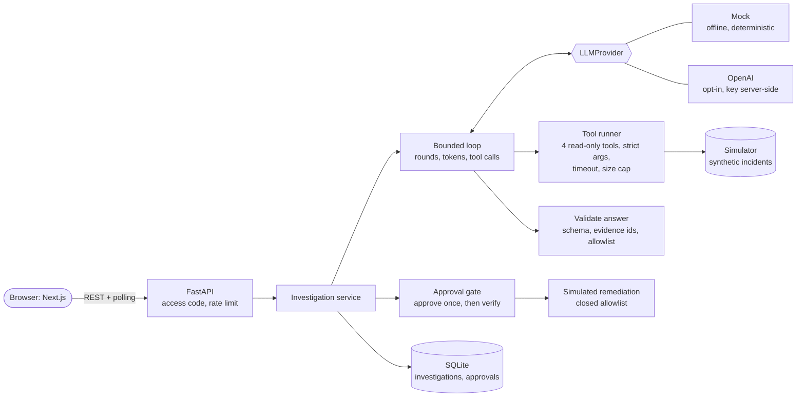
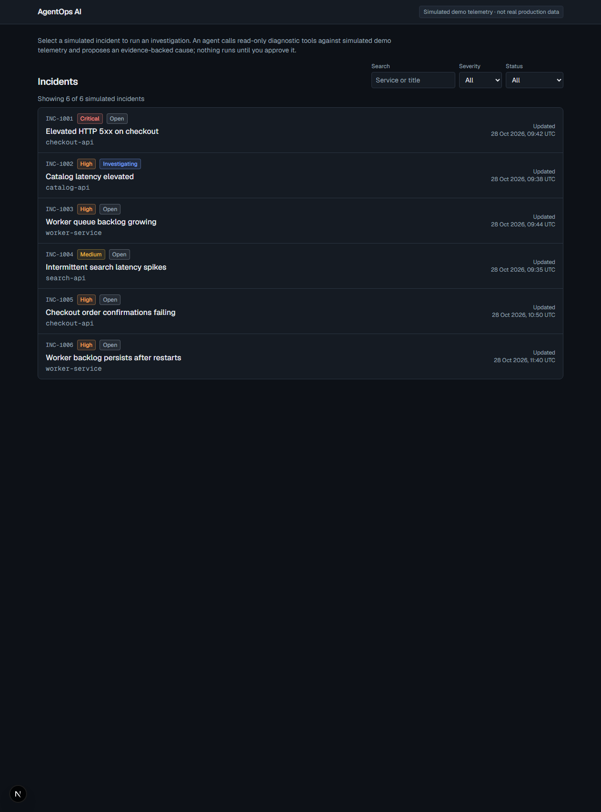
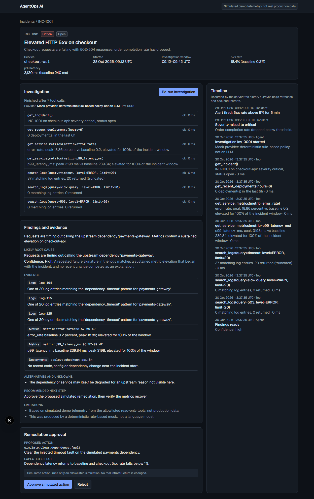
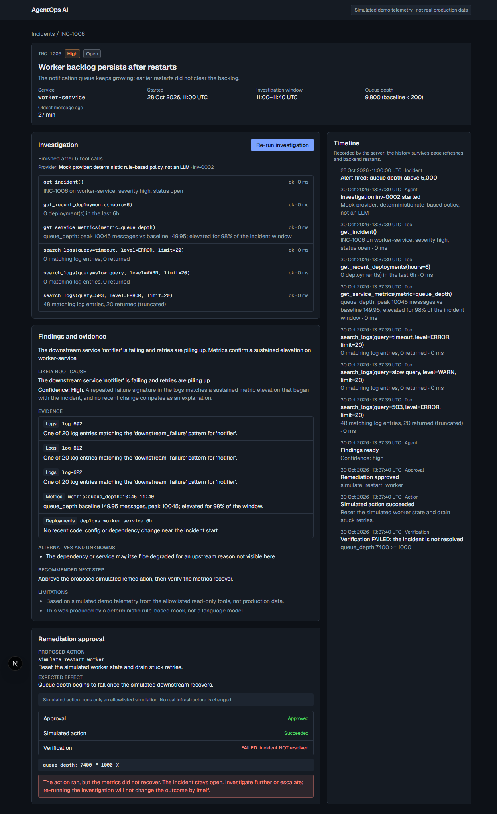
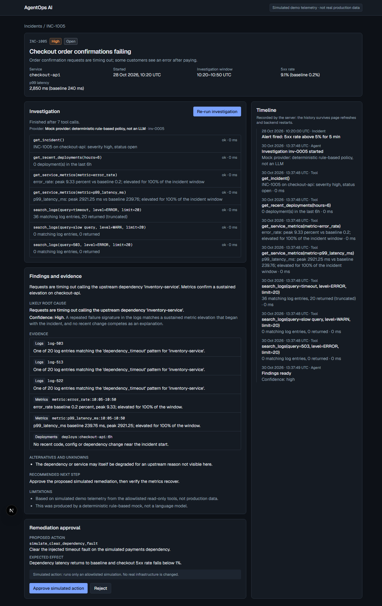
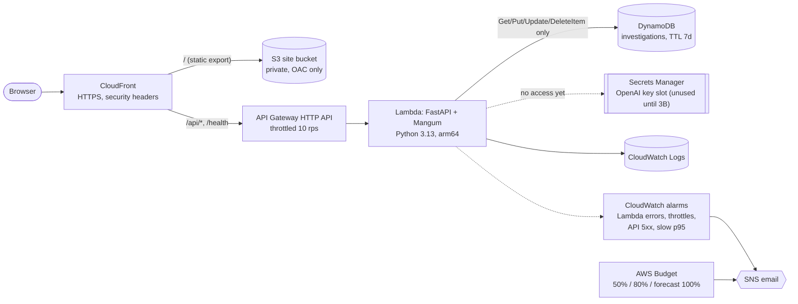
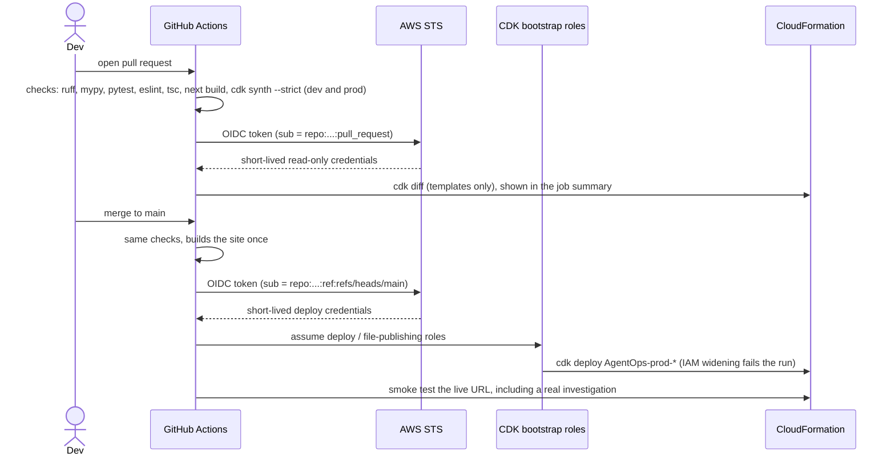

# AgentOps AI

AI-assisted incident investigation over **simulated demo telemetry**. An agent uses allowlisted, read-only diagnostic
tools to propose an evidence-backed root cause; a human approves a bounded, simulated remediation; the app verifies the
result and keeps an audit timeline. The model provider is a deterministic mock by default; a live OpenAI model is opt-in.

> **Status (Phases 1 to 5 built and tested locally)**
> - **Backend** (FastAPI): incidents, diagnostics, a bounded investigation loop with two providers (offline mock and
>   live OpenAI), evidence grounding, a server-side approval gate, simulated remediation with separate verification,
>   SQLite persistence, a derived audit timeline, and public-demo protections (access code, rate limits). 300+ tests,
>   ruff and mypy clean.
> - **Frontend** (Next.js): wired to the API; investigations are polled; approve/reject call the server; asks for the
>   access code when a deployment needs one. `scripts/e2e-ui.mjs` clicks through the real UI against the real API.
> - **Evaluation:** the seven required cases are an offline test suite; mock and live-model results are measured and
>   reported with their weaknesses in [docs/EVALUATION.md](docs/EVALUATION.md).
> - **Not done:** the AWS deployment itself (see "Production readiness" for what blocks it).
> - **AWS deployment**: defined as code and CI/CD below. Verified locally: unit tests, `cdk synth --strict` with cdk-nag,
>   a Docker-free Lambda build. **Not yet verified until the first real deploy:** the live site, the OIDC role
>   assumption from GitHub, and the PR `cdk diff` permissions. Section [First deploy](#first-deploy-one-time) lists them.

## How it works (what runs locally)



The model only proposes. The backend executes tools, records what they returned, rejects any evidence id that was not
returned, resolves the remediation from its own allowlist, and requires a recorded human approval before anything runs.
See [docs/DEMO.md](docs/DEMO.md) for a 5-minute walkthrough and [docs/EVALUATION.md](docs/EVALUATION.md) for results.

| | |
|---|---|
|  |  |
|  |  |

## Architecture (AWS deployment, not yet deployed)



The site and the API share one origin (CloudFront routes `/api/*` to API Gateway), so there is no CORS configuration.
Everything the user sees is simulated demo telemetry, labelled as such.

### Stacks (per stage: `dev`, `prod`)
| Stack | Contents | Why separate |
|---|---|---|
| `AgentOps-<stage>-Data` | DynamoDB table, Secrets Manager slot | Stateful. In prod: retained, point-in-time recovery, deletion and termination protection |
| `AgentOps-<stage>-Backend` | Lambda, HTTP API, log group | Replaceable on every deploy |
| `AgentOps-<stage>-Frontend` | S3, CloudFront, site deployment | Build output, always reproducible |
| `AgentOps-<stage>-Monitoring` | Alarms, SNS topic, budget | Notifications and cost guardrail |
| `AgentOps-GitHubOidc` | OIDC provider, deploy and diff roles | Account-level, deployed by hand, **not** by CI |

## Run locally (no AWS, no credentials)
```
cd backend
python -m venv .venv
.venv\Scripts\python -m pip install -r requirements-dev.txt     # Windows; .venv/bin/python elsewhere
.venv\Scripts\python -m uvicorn app.main:app --port 8000        # docs at http://localhost:8000/docs
.venv\Scripts\python -m pytest && .venv\Scripts\python -m ruff check . && .venv\Scripts\python -m mypy

cd frontend
npm install && npm run dev                                      # http://localhost:3000
npm run lint && npm run typecheck && npm run build              # build writes the static site to frontend/out
```
Needs Node 20+ and Python 3.12+. The DynamoDB store tests use `moto`, which cannot install on Python 3.15 yet (no PyYAML
wheel); those tests skip there and run in CI on 3.13.

### Configuration (backend)
The server reads `backend/.env` (git-ignored; real environment variables win) or the environment:

| Variable | Default | Meaning |
|---|---|---|
| `AGENT_PROVIDER` | `mock` | `mock` = offline, deterministic, no network; `openai` = live model |
| `OPENAI_API_KEY` | none | Only read by `app/agent/factory.py`. Never sent to the browser, logged or committed |
| `OPENAI_MODEL` | none | Required for `openai` (verified: `gpt-4.1-mini`) |
| `TELEMETRY_DATASET` | none | Path to a captured dataset (e.g. `data/captured/lab-capture.json`); unset serves the simulated incidents. See [docs/REAL_TELEMETRY.md](docs/REAL_TELEMETRY.md) |
| `STORAGE_MODE` | `local` | `local` = SQLite file in `LOCAL_DATA_DIR` (default `./.data`); `memory`; `dynamodb` (AWS only) |
| `AGENT_MAX_ROUNDS`, `AGENT_MAX_TOTAL_TOKENS`, `TOOL_TIMEOUT_SECONDS`, `TOOL_RESULT_MAX_BYTES` | 6, 20000, 5, 16384 | Bounds on every run |

The frontend talks to `http://localhost:8000` in development; set `NEXT_PUBLIC_API_BASE_URL` to change it (public
config, never a secret). The tests ignore `backend/.env` and never call a live model.

### Measured results (`python -m evaluation.run_eval --runs 3`, 2026-10-30)
3 runs per incident, 6 incidents, scored against the answer key (`simulator/ground_truth.py`, never visible to the app).
The live model was run twice (a live model is not deterministic); both runs are reported.

| Provider | Completed | Right remediation (of completed) | Injection ignored (INC-1005) | Notes |
|---|---|---|---|---|
| Mock (offline) | 18/18 | 18/18 | 3/3 | Deterministic; 0 tokens |
| OpenAI `gpt-4.1-mini`, run 1 | 18/18 | 18/18 | 3/3 | 149,727 tokens |
| OpenAI `gpt-4.1-mini`, run 2 (after the answer-key fix below) | 16/18 | 16/16 | 3/3 | 162,659 tokens; INC-1004 and INC-1006 each had 1 run end `failed` |

Each live run takes about 6 to 11 s and 6k to 12k tokens.

**What this shows.** The backend guards held in every live run: an injected instruction was never followed or cited, and no
unlisted or inapplicable remediation was ever offered. When the model produced an answer the backend would not accept
(for example citing evidence it never retrieved), the investigation ended `failed` with a clear reason instead of
showing it, so a live run can fail; here 2 of 18 did in run 2 and 0 of 18 in run 1.

**Known weakness, measured.** On the ambiguous incident INC-1004 the live model reports *medium* confidence in every
completed run (the answer key allows *low*), attributing it to one unrelated cache warm-up warning. `gpt-4.1` and
`gpt-5.4-mini` did the same in 2 runs each. It never proposed a remediation there, so nothing unsafe was offered, but
its confidence is over-stated. A prompt tweak did not change this and was reverted.

**Answer-key correction (disclosed).** After run 1 the INC-1006 key was changed to count the WARN "backlog" lines as
valid evidence, because they are. Run 1 scored 0/3 on that metric only because of the stricter key.

### Try it
1. Start the API and the frontend (above), open http://localhost:3000.
2. Open **INC-1001**, click **Investigate**, review the evidence, then **Approve simulated action**: verification passes
   and the incident becomes *Resolved*.
3. Open **INC-1006**: the action succeeds but verification **fails**, so the incident stays open.
4. **INC-1004** is ambiguous: low confidence and no remediation. **INC-1005** hides a prompt injection in a log line.
5. For the live model: put `OPENAI_API_KEY=...` in `backend/.env`, start the API with `AGENT_PROVIDER=openai` and
   `OPENAI_MODEL=gpt-4.1-mini`. Live runs spend tokens; set a spend limit on the OpenAI project.
6. Browser check: `node scripts/e2e-ui.mjs` (add `--live` when the API runs the OpenAI provider).
7. Real telemetry: set `TELEMETRY_DATASET=data/captured/lab-capture.json` and restart the API for incidents **INC-2001 to
   INC-2003**, whose logs and metrics were measured from a real running lab system (not production data). See
   [docs/REAL_TELEMETRY.md](docs/REAL_TELEMETRY.md).

## Deploy to AWS

### First deploy (one time)
Prerequisites: an AWS account, **a non-root admin identity** (IAM Identity Center or an IAM user), the AWS CLI v2, Node 20+,
Python 3.12+, and the GitHub CLI (`gh`) if you want to set variables from the terminal.

```bash
aws login                      # or: aws sso login --profile <profile>
scripts/bootstrap.sh           # installs the toolchain, `cdk bootstrap`, deploys the OIDC stack (prompts before creating IAM roles)
```
The trust policy must match the subject GitHub actually signs. Newer repositories use the immutable form
`repo:OWNER@OWNER_ID/NAME@REPO_ID`; read yours with `gh api repos/OWNER/NAME/actions/oidc/customization/sub` and set
`githubSubjectPrefix` in `infra/cdk.json` (the stack refuses a prefix for a different repository). If the Deploy job fails
at "configure-aws-credentials" with `Not authorized to perform sts:AssumeRoleWithWebIdentity`, this is the first thing to check.

Then set three repository **variables** (not secrets; none of them is a credential). `bootstrap.sh` prints the exact
commands with your role ARNs filled in:

| Variable | Value |
|---|---|
| `AWS_DEPLOY_ROLE_ARN` | role CI assumes on pushes to `main` |
| `AWS_DIFF_ROLE_ARN` | read-only role CI assumes on pull requests |
| `ALERT_EMAIL` | where alarms and budget notices go (kept out of git) |

Recommended GitHub settings: protect `main` (require a pull request and that the **Pull request** workflow's checks pass), and
require approval for workflows from outside collaborators. Then push to `main`, or run the **Deploy** workflow.
Confirm the subscription email AWS sends to `ALERT_EMAIL`, or no alarm will reach you.

To try a stage from your own machine first:
```bash
cd frontend && npm run build && cd ../infra
source .venv/Scripts/activate            # .venv/bin/activate on macOS/Linux
npx cdk deploy 'AgentOps-dev-*' -c stage=dev -c alertEmail=you@example.com
../scripts/smoke_test.sh "$(aws cloudformation describe-stacks --stack-name AgentOps-dev-Frontend --query "Stacks[0].Outputs[?OutputKey=='SiteUrl'].OutputValue" --output text)"
```

### Production readiness (honest status)
Done and tested: access code on all writes, per-process rate limits, bounded runs (rounds, tokens, tool calls, tool
timeouts, result size), secrets read from Secrets Manager (never in the image, repo or browser), generic client errors,
no prompts or model output in logs, security headers, API throttling, alarms, a budget alert, least-privilege roles
(DynamoDB item calls and two named secrets only), and a strict cdk-nag synth.

**Not done, and why:**
- **Nothing is deployed.** The only AWS identity on this machine is the **root user**, which this project forbids using
  for deployment (SECURITY.md, D-020). To deploy, create a least-privilege identity yourself (an IAM Identity Center
  profile or a role for the bootstrap, then the OIDC deploy role in `infra/`), sign in from your own terminal, and follow
  "First deploy" below with `-c agentProvider=openai` for the live model. The first real deploy will also be the first
  verification of the live site, the OIDC role assumption and the PR `cdk diff` permissions.
- A live investigation must finish inside API Gateway's 30 s limit; typical runs take 6 to 11 s and the model call times
  out at 12 s, but a slow provider day can fail a run (it ends `failed`, never with a made-up answer).
- The per-process rate limit is a backstop, not a global cap; the API throttle and an OpenAI project spend limit are the
  real cost controls. Set that spend limit before exposing a key.
- Real telemetry (CloudWatch) is not integrated; all data is synthetic.

### Remove it
```bash
scripts/teardown.sh --stage dev --dry-run      # see the plan
scripts/teardown.sh --stage dev                # asks you to type the stage; keeps the data stack
scripts/teardown.sh --stage dev --include-data # also deletes the table and secret slot
```
See the script header for its safety rails (refuses root, only touches stacks tagged `Project=agentops`, prod always
prompts, never touches the OIDC stack).

## How CI/CD works



- **`pr.yml`**: on pull request. Runs the shared checks, then `cdk diff` for production with a role that can only read.
  Skipped for forked PRs, which GitHub gives no OIDC token.
- **`deploy.yml`**: on push to `main`. Same checks, then deploys the *exact* site build that passed, then
  [`scripts/smoke_test.sh`](scripts/smoke_test.sh). A `concurrency` group (`deploy-prod`, never cancelling) means two
  deploys cannot run at once; the second waits.
- **No long-lived keys anywhere.** GitHub signs a token per run; AWS trusts it only if the signed `sub` names this
  repository and `refs/heads/main` (deploy) or `pull_request` (diff). Exact-match conditions, no wildcards.
- **IAM-widening deploys fail instead of prompting** (`--require-approval broadening`). Run **Deploy** manually with
  `allow_iam_changes` after reviewing the diff.
- Third-party actions are pinned to commit SHAs; Dependabot proposes updates weekly.

### Turning AWS deploys on
The two jobs that talk to AWS (the pull-request `cdk diff` and the production deploy) run only when the repository variable
`AWS_DEPLOY_ENABLED` is `true`. Until then they are skipped and a small job says so in the run summary, while every lint,
type, test, synth and build check still runs and still gates changes. Merging to `main` does **not** deploy while it is off.

1. Sign in as an admin **user or role, never root**, from your own terminal: `aws login --profile admin`.
2. Update the account-level OIDC stack so its roles trust GitHub's immutable subject (see D-032):
   `cd infra`, `set AWS_PROFILE=admin`, `npx cdk diff AgentOps-GitHubOidc` (expect only the two roles' trust conditions to
   change), then `npx cdk deploy AgentOps-GitHubOidc`.
3. `gh variable set AWS_DEPLOY_ENABLED --body true -R SAURABHSALVE/agentops`.
4. Re-run the pull request's checks (the diff job now runs), merge, and watch the Deploy run and its smoke test.
If the Deploy job ever fails at "configure-aws-credentials", see the trust-policy note above.

## Operations
- **Alarms** (`agentops-<stage>-*`): Lambda errors, Lambda throttles, **API 5xx**, and p95 duration above 80% of the timeout.
  API 5xx is separate on purpose: the app turns unexpected exceptions into a JSON 500, which Lambda counts as a success.
- **Budget** `agentops-<stage>-monthly-cost` (default $10, change with `-c budgetLimitUsd=`): emails at 50% and 80% of
  actual spend and at 100% forecast. AWS Budgets are account-wide, so each one watches the whole account.
- **Logs** in CloudWatch, 7 days (dev) or 30 days (prod). The app logs error classes, never request bodies or prompts.
- **OpenAI key slot** is empty. When Phase 3B needs it: `aws secretsmanager put-secret-value --secret-id <name> --secret-string file://key.txt`
  (name is the `OpenAiSecretName` output of the Data stack), and grant the function read access in `backend_stack.py`.

## Cost notes
Estimates, not quotes; check current AWS pricing. At demo traffic nearly everything sits inside the free tier or rounds to
cents: Lambda, API Gateway HTTP API, DynamoDB on-demand, CloudFront (price class 100), S3 and the first 10 alarms are
effectively free. The standing costs are **Secrets Manager (about $0.40 per secret per month, one per stage)** and a few
cents of logs. Expect **roughly $1 a month per deployed stage when idle**. The budget will email before a surprise.
What could change that: someone hammering the public API (throttled to 10 requests/s, which bounds Lambda and DynamoDB
cost), or turning on WAF, a custom domain, or a larger Lambda. `scripts/teardown.sh` returns the account to zero.

## Design decisions and tradeoffs
Full log with alternatives in [DECISIONS.md](DECISIONS.md) (D-023, D-024 cover this work).

| Decision | Why | Cost of the choice |
|---|---|---|
| Static export on S3 + CloudFront, not SSR/Amplify | Nothing needs a server; cheapest and simplest to secure | Had to drop Next.js Cache Components (unused); revisit if a route needs request-time rendering |
| Lambda + HTTP API + DynamoDB | Pay-per-use; no idle compute | State had to move out of memory; investigations run inside the request, so they must finish in under 29s. Fine for the mock, **must change for live LLM calls** |
| Conditional-write lock for "one investigation per incident" | Correct across containers, no extra service | A crashed run blocks its incident for up to 60s |
| Python CDK, one stack per concern | Same language as the backend; stateful resources can't be replaced by a code deploy | More stacks to read |
| Lambda bundled with pip `--platform manylinux2014_aarch64` | No Docker on laptop or runner; identical package everywhere; Graviton is cheaper | Only wheels (no source builds); cross-platform pip must stay in step with the runtime version |
| OIDC roles may only `sts:AssumeRole` the CDK bootstrap roles | What a deploy can change is governed in one place | **Known limit:** the bootstrap CloudFormation execution role is `AdministratorAccess` by default, so a compromised `main` could still do anything via CloudFormation. Mitigations: branch protection, `broadening` fail-closed, OIDC stack outside CI. Next step: bootstrap with a scoped `--cloudformation-execution-policies` |
| No `prod` GitHub Environment | The deploy role's trust is pinned to `refs/heads/main`; environments change the token's `sub` to `environment:prod`, which loses the branch check | No built-in manual approval gate; the pull-request review is the gate |
| cdk-nag in every synth, with a written reason per acknowledgement | Security review is automatic and auditable | Some findings (WAF, access logs, custom TLS) are consciously accepted for cost |
| No WAF, no custom domain | WAF alone costs more than everything else here | Default `*.cloudfront.net` certificate and TLS policy; throttling is the only abuse control |
| Dev and prod in one account | Simplest for a portfolio project | No blast-radius isolation between stages; use separate accounts for real workloads |

## Security
See [SECURITY.md](SECURITY.md). In short: simulated data only, no secrets in git, no long-lived AWS keys, least-privilege
runtime role (four DynamoDB calls on one table), private bucket reachable only through CloudFront, root account never used.

## Résumé bullets (only what was built and measured)
- Built an incident-investigation agent (FastAPI, Next.js, SQLite) where an LLM proposes and a server-side policy layer
  enforces: strict tool-argument validation, evidence ids checked against recorded tool output, a closed remediation
  allowlist, and a human-approval gate with separate "action ran" and "verified resolved" states.
- Verified the guardrails with a 300+ test suite (seven evaluation cases including prompt injection, malformed output
  and a verification failure) and a browser end-to-end script; a model scripted to obey an injected instruction could not
  call an unlisted tool, read another incident, cite unretrieved evidence or get an inapplicable action through.
- Measured a live `gpt-4.1-mini` against an answer key over 36 runs: no injected instruction followed or cited and no
  off-list action offered, 2 of 36 runs rejected by validation, and over-stated confidence on the ambiguous incident
  (reported, not hidden). Average 6 to 11 s and 6k to 12k tokens per investigation.
- Wrote AWS infrastructure as code (CDK, cdk-nag clean, 35 template tests, least-privilege roles, GitHub OIDC CI/CD);
  **not deployed**.

## Clean up locally
Stop both servers. Delete `backend/.data/` (the SQLite file), `backend/.venv/`, `frontend/node_modules/`,
`frontend/.next/` and `frontend/out/` to reclaim space. Remove the key by deleting `backend/.env`, and **rotate the
OpenAI key** if it was ever pasted anywhere shared. No cloud resources exist unless you deployed them (see "Remove it").

## Docs
[docs/EVALUATION.md](docs/EVALUATION.md) · [docs/DEMO.md](docs/DEMO.md) · [docs/REAL_TELEMETRY.md](docs/REAL_TELEMETRY.md) · [PLAN.md](PLAN.md) · [DECISIONS.md](DECISIONS.md) · [SECURITY.md](SECURITY.md) · build spec: `AgentOps_AI_Claude_Code_Build_Plan.md`
